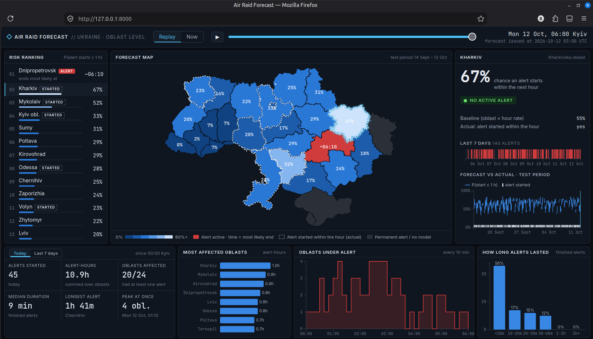
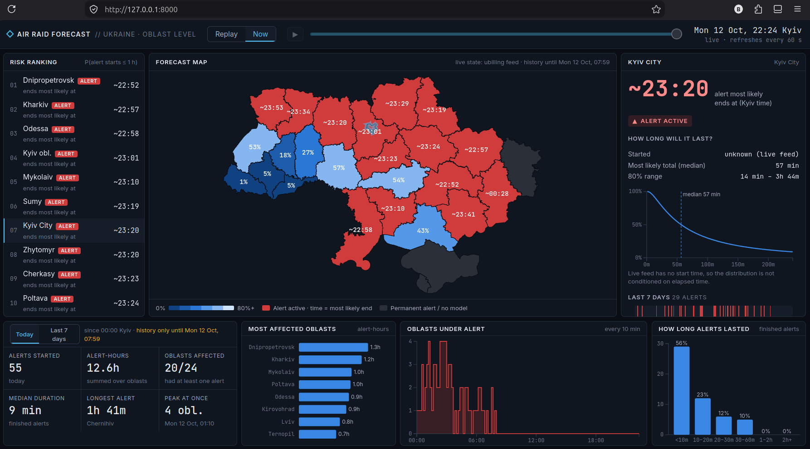
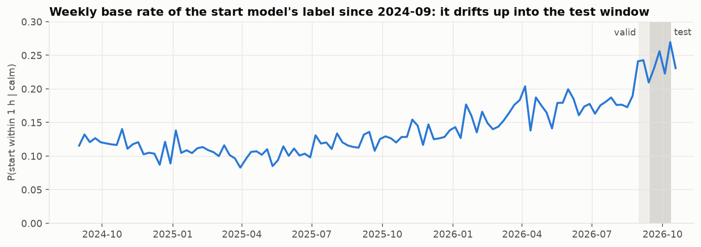
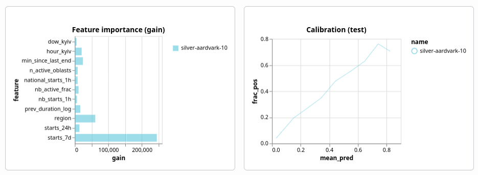
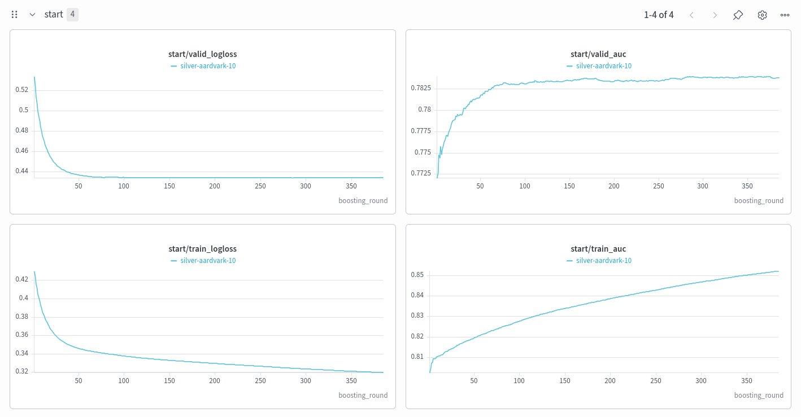

# Air Raid Alert Forecast (Ukraine, oblast level)

Forecasting air-raid alerts in Ukraine's oblasts from the public alert history, with a dark "ops" dashboard to replay and watch the forecasts. Built in one day as a Stage 2 project for an AI agentic school, using Claude Code as the main engineering tool. The full AI conversation is in [`claude_conversation/`](#ai-conversation-log).


*Replay mode on 12 Oct 06:00. Blue shades show P(alert starts within 1 h), red shows active alerts with their most likely end time, and dashed outlines mark alerts that actually started within that hour. Right: the selected oblast's forecast vs the seasonal baseline and vs what happened.*

## What it does

For each of 24 oblasts, two questions:

1. **Will an alert start within the next hour?** *(start model, LightGBM)* Asked only while the oblast is calm.
2. **If an alert is on, how long will it last?** *(duration model, log-normal survival model)* The answer is a full distribution: median, 80% range, and a survival curve conditioned on the time already elapsed.

The dashboard shows both on a map of Ukraine:
- **Replay** steps through the test period and shows forecast vs what actually happened.
- **Now** uses the live alert feed.

<details>
<summary>Now mode screenshot (live, 12 Oct 22:24)</summary>


*For an active alert, the panel shows the expected end, the median and 80% range, and the survival curve. Here the alert's start time is unknown (it was already on when the server started), so the curve isn't conditioned on elapsed time.*
</details>

## Quick start

```bash
uv sync
uv run python -m app              # dashboard at http://127.0.0.1:8000 (trained models are committed)
uv run python -m training.train   # optional: retrain (~20 s, downloads the data; --no-wandb to skip W&B)
uv run pytest                     # leakage tests
```

Running each study, the project layout and the full numbers: [`docs/DETAILS.md`](docs/DETAILS.md).

## How it works

- **Data:** the volunteer (eTryvoga) file of [Vadimkin/ukrainian-air-raid-sirens-dataset](https://github.com/Vadimkin/ukrainian-air-raid-sirens-dataset), updated daily.
  - The official file stopped on 2026-09-07, so it can't be used to evaluate on the latest period.
  - Luhansk, Crimea and Sevastopol are under permanent alert, so they have no model.
- **Features** describe recent activity: the oblast's starts in the last 24 h and 7 d, time since its last alert, the duration of its last alert, how many oblasts are on alert, national starts in the last hour, the neighbours' state, and hour/weekday.
- **No leakage.**
  - A forecast at time t uses only alerts that started before t, and end times only of alerts already over by t.
  - `tests/test_no_leakage.py` recomputes every feature on data cut off at t and checks it's identical. A negative control and an injected 1 h leak prove the test can fail.
  - The dashboard imports the same feature code, so training and serving can't diverge.
- **Evaluation** is on the most recent data, split by time:
  - train → 14-day validation, which picks every setting;
  - → refit → **28-day test (14 Sep – 12 Oct 2026)**, scored once.
  - Gains come with 90% intervals that resample whole days (alerts come in waves).

## Results (test period)

| Start model (calm oblast-hours) | Log loss ↓ | ROC-AUC ↑ |
|---|---|---|
| **LightGBM** | **0.454** | **0.783** |
| Recency baseline (logistic regression, 5 recency features + hour) | 0.462 | 0.769 |
| `starts_7d`-only baseline | 0.465 | 0.764 |
| Seasonal-naive baseline (rate per oblast × hour) | 0.511 | 0.739 |

- **Most of the predictability is "recent activity".** A one-feature `starts_7d` baseline recovers ~80% of the gap between the seasonal baseline and LightGBM.
- **The model's honest margin over a recency baseline is small but real:** −0.008 log loss, 90% CI [−0.011, −0.005].
- **Drift:** the base rate rose from 13% (train) to 24.5% (test). The model still under-predicts slightly (mean 0.228 vs 0.245).




*From Weights & Biases. `starts_7d` dominates the feature importance, which matches the baseline result. On calibration, the model under-predicts in the 0.1–0.5 range, consistent with the drift. (This W&B run was logged before the final retrain with recency weights; the committed model has the same pattern, with `starts_7d` at 63% of the gain.)*

| Duration model | Log-normal AFT | Per-oblast median |
|---|---|---|
| 80% interval coverage | 81% | – |
| MAE of the median | 18.8 min | 19.5 min (Δ −0.8 [−1.0, −0.6]) |

The duration model's value is its calibrated distribution. The point estimate is only ~4% better than the per-oblast median.

<details>
<summary>Training curves (W&B): early stopping on validation log loss</summary>


*Validation log loss flattens after about 100 rounds while train log loss keeps falling. Early stopping picks the round count, and the final model is refit on train+validation with it. Same caveat as above: this is an earlier run.*
</details>

**Time-series analysis** (`exploration/00_time_series_eda.py`, figures in `docs/figures/`):
- Daily alert starts doubled from 2022 to 2026.
- There is a strong time-of-day cycle but almost no weekday effect.
- Starts are autocorrelated for days (waves).
- Alerts are getting shorter: the median went from 38 min to 21 min.

## How the project evolved

Every change was tested on validation only. Since the two-window rule was introduced (session 3), a change is kept only if it wins on **two different validation fortnights**. Numbers and scripts are in [`docs/DETAILS.md`](docs/DETAILS.md#validation-studies-behind-each-decision).

| # | Session | What happened |
|---|---|---|
| 1 | MVP (history-1) | Found that the official data stops on 2026-09-07 and switched to the volunteer feed. Built both models, the leakage tests and the dashboard. Claude caught its own wrong claim about Luhansk and mutation-tested its own leakage test. |
| 2 | Model review (history-1) | My ideas, tested: sin/cos time encoding (**rejected**, raw is slightly better for trees) and neighbour features (**adopted**). Discussed why not an LSTM: a small dataset, no GPU and a few-minute training budget; gradient boosting on lag features is the stronger, cheaper choice here. |
| 3 | Features (history-2) | Weather at oblast centroids and at drone launch sites (**rejected**: no gain at 1 h). Then my feature ideas: previous alert duration (**adopted**), neighbours and recency features in the duration model (**adopted**), and counting active oblasts 5 min after the start (**rejected**). Introduced the two-window + bootstrap rule. |
| 4 | Mock review (history-3) | Asked a fresh Claude session to judge the project ([`FEEDBACK.md`](claude_conversation/FEEDBACK.md)). Main findings: the baseline was too weak, the training window was untested, the "clearly better" duration claim was overstated, Now mode was inconsistent, and there was no descriptive analysis. |
| 5 | Fixes (history-4) | Added recency baselines and test CIs: the real margin is 0.008, not 0.06. Training window: length doesn't matter; recency weighting adopted for a small gain. Weibull vs log-normal: Weibull fits the distribution better but has a worse median, and **I chose log-normal**. Fixed Now mode, added the EDA, and restored the full logs with tool outputs. |

## Limitations

- **Small margin over simple baselines.** Recent activity explains most of what is predictable 1 h ahead.
- **Drift.** The alert rate keeps rising, and the model trails it slightly. It needs frequent refits (training takes ~20 s).
- **Now mode:**
  - The daily dump lags up to ~24 h.
  - The live feed gives no start times. If the server didn't see an alert begin, its elapsed time is unknown, so the expected end is too late.
- **Missing end times.** Alerts with unknown ends (~8% of the test period) are excluded from the duration model. They may not be a random subset.
- **Oblast level only.** The official data moved to raion level in 2025, but that file stopped updating.

## Future work

- **Text data:** Ukrainian Air Force Telegram posts (`t.me/s/kpszsu`, public and timestamped) about drones or missiles in the last hour, run through the same two-window test.
- **A Hawkes process** (self-exciting point process) as a textbook model for alerts that come in waves.
- **Longer horizons (6–24 h)**, where weather may finally help.
- **Better Now mode:** a live source with start times, plus scheduled daily refits.
- **Raion-level models**, if official data resumes.

## AI conversation log

All work was done with Claude Code (Claude Opus 5.5). The logs are in [`claude_conversation/`](claude_conversation/):

| File | Contents |
|---|---|
| `history-1-setup-and-mvp.txt` / `.full.txt` | Data research, MVP plan and build, leakage tests, first model review |
| `history-2-feature-and-model-improve.txt` / `.full.txt` | Weather study, model questions, feature experiments |
| `history-3-critique-and-judgement.txt` | Mock review by a fresh session → [`FEEDBACK.md`](claude_conversation/FEEDBACK.md) |
| `history-4-fixes-after-review.full.txt` | Fixes after the review, and this README |

- `.txt` files are terminal exports; tool outputs are collapsed there.
- `.full.txt` files are rendered from the raw Claude Code session files by [`render_jsonl.py`](claude_conversation/render_jsonl.py). They include every tool call and its output (long outputs capped at 150 lines), so you can see the numbers the AI was looking at.
